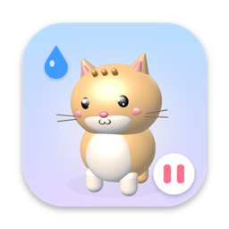
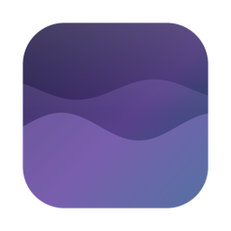
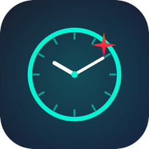

## 💫 About Me
- 🔭 Software Development Engineer II (SDE 2) at [Fegno Technologies](https://fegno.com), building macOS apps, Android tools and websites.
- 🌱 Currently exploring Swift, 3D on the web and motion design.
- 💬 Ask me about Flutter or any tech-related stuff.
- 📫 How to reach me: Check social links below.

## 🛠️ My Builds
<table>
  <tr>
    <td>&nbsp;<b><a href="https://mediashift.app">MediaShift</a></b></td>
    <td>In-browser media converter (ffmpeg.wasm)</td>
    <td><a href="https://mediashift.app">Site</a></td>
  </tr>
  <tr>
    <td>&nbsp;<b><a href="https://salahu01.github.io/unadly/">Unadly</a></b></td>
    <td>Mac browser that blocks ads before they load</td>
    <td><a href="https://salahu01.github.io/unadly/">Site</a> · <a href="https://github.com/salahu01/unadly-macos">Code</a></td>
  </tr>
  <tr>
    <td>&nbsp;<b><a href="https://salahu01.github.io/pawse/">Pawse</a></b></td>
    <td>3D desktop pet for Mac: water, habits, breaks</td>
    <td><a href="https://salahu01.github.io/pawse/">Site</a> · <a href="https://github.com/salahu01/pawse-app">Code</a></td>
  </tr>
  <tr>
    <td>&nbsp;<b><a href="https://salahu01.github.io/livewall/">LiveWall</a></b></td>
    <td>Low-power live video wallpaper for macOS</td>
    <td><a href="https://salahu01.github.io/livewall/">Site</a> · <a href="https://github.com/salahu01/livewall-app">Code</a></td>
  </tr>
  <tr>
    <td>&nbsp;<b><a href="https://salahu01.github.io/globber/">Globber</a></b></td>
    <td>Offline pattern-matching call blocker for Android</td>
    <td><a href="https://salahu01.github.io/globber/">Site</a> · <a href="https://github.com/salahu01/globber-app">Code</a></td>
  </tr>
  <tr>
    <td>&nbsp;<b><a href="https://salahu01.github.io/glint/">Glint</a></b></td>
    <td>Always-on-top time-awareness clock for macOS</td>
    <td><a href="https://salahu01.github.io/glint/">Site</a> · <a href="https://github.com/salahu01/glint-app">Code</a></td>
  </tr>
  <tr>
    <td>&nbsp;<b><a href="https://salahu01.github.io/quietfolio/">Quietfolio</a></b></td>
    <td>Minimal, SEO-first portfolio template</td>
    <td><a href="https://salahu01.github.io/quietfolio/">Site</a> · <a href="https://github.com/salahu01/quietfolio-template">Code</a></td>
  </tr>
  <tr>
    <td>&nbsp;<b><a href="https://salahu01.github.io">3D Portfolio</a></b></td>
    <td>Walkable 3D developer room portfolio</td>
    <td><a href="https://salahu01.github.io">Site</a> · <a href="https://github.com/salahu01/salahu01.github.io">Code</a></td>
  </tr>
  <tr>
    <td>&nbsp;<b><a href="https://salahu01.github.io/fegno-journey/">Fegno Journey</a></b></td>
    <td>Scrollytelling timeline of 3 years at Fegno</td>
    <td><a href="https://salahu01.github.io/fegno-journey/">Site</a> · <a href="https://github.com/salahu01/fegno-journey">Code</a></td>
  </tr>
</table>

## 🌐 Socials

<!-- ## 💼 Hire Me

#### 📞 : +91 8590811546
#### 📨 : cvsalahu12@gmail.com -->

